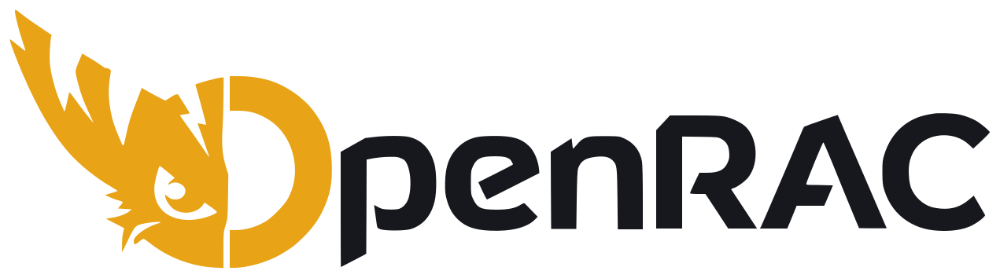

<p align="center">
  <a href="https://openrac.dev/">
    <picture>
      <source media="(prefers-color-scheme: dark)" srcset="docs/assets/openrac-logo-dark.svg">
      
    </picture>
  </a>
</p>

<h3 align="center">Ratchet &amp; Clank decompilation project</h3>

<p align="center">
  <a href="https://bytematch.dev/OpenRAC/rac1-decomp"></a>
  <a href="https://github.com/OpenRAC/rac1-decomp/actions/workflows/ci.yml"></a>
  <a href="https://openrac.dev/"></a>
  <a href="https://discord.gg/Sfd2B54PDG"></a>
</p>

<p align="center">
  A matching decompilation of <i>Ratchet &amp; Clank</i> (2002) for PlayStation 2.<br>
  The game code, rebuilt as readable C that matches retail byte for byte.
</p>

> [!WARNING]
> This repository has no game data, executables, disc images or proprietary toolchains.
> You need your own copy of the game. Read [LEGAL.md](LEGAL.md) before contributing.

## Progress

All 5116 functions of the PAL v2.00 executable match. The work now is making the code easier to read:
names, types and structs. Live numbers are on [ByteMatch](https://bytematch.dev/OpenRAC/rac1-decomp).

## Supported versions

| Release | Region | Boot executable | Code | Notes |
| --- | --- | --- | --- | --- |
| v2.00 | PAL (Europe) | `SCES_509.16` | [](https://bytematch.dev/OpenRAC/rac1-decomp) | Primary version |
| v1.00 | PAL (Europe) | `SCES_509.16` | [](https://bytematch.dev/OpenRAC/rac1-decomp/SCES_509.16_v1) | Report id `SCES_509.16_v1` |
| v1.02 | NTSC-J | `SCPS_150.37` | [](https://bytematch.dev/OpenRAC/rac1-decomp/SCPS_150.37) | Shares the PAL C source, with its own code where the bytes differ |
| v1.00 | NTSC-U | `SCUS_971.99` | [](https://bytematch.dev/OpenRAC/rac1-decomp/SCUS_971.99) | ByteMatch shows [Lombyte](https://github.com/lombyte-project/Lombyte)'s count, the NTSC-U decompilation |

All versions share one C source. Expected SHA-1 of the primary executable:

```text
79956931bd62fafd8d20fa2eae796dbaf2e15e83
```

How the versions fit together: [docs/build/versions.md](docs/build/versions.md).

## Quick setup

On Linux and macOS the build runs in a container, so you need [Docker](https://www.docker.com/) or
[Podman](https://podman.io/).

```sh
git clone https://github.com/OpenRAC/rac1-decomp.git && cd rac1-decomp
cp /path/to/SCES_509.16 baserom/              # the executable from your disc
cp /path/to/your-disc.iso baserom/SCES_509.16.iso
git clone https://github.com/AngheloAlf/SN-Systems-ProDG_for_PS2_3.01 toolchain/sn-prodg-3.01
git clone https://github.com/AngheloAlf/sce_ps2_sdk_24 toolchain/sn-prodg-24
bash tools/setup_compilers.sh
bash tools/docker/run.sh python3 tools/gcc323.py --setup
bash tools/docker/run.sh python3 tools/overlays.py dump
bash tools/docker/run.sh bash tools/setup_asm.sh
bash tools/docker/run.sh bash tools/build_sn.sh
```

Windows, the other versions and every step in detail: [docs/build/building.md](docs/build/building.md).

## Contributing

Start with [CONTRIBUTING.md](CONTRIBUTING.md). All docs are listed in [docs/README.md](docs/README.md):

- [docs/build/](docs/build) - building, toolchain, versions and level code
- [docs/contributing/](docs/contributing) - matching workflow, code style, names and reviews
- [docs/game/](docs/game) - how the game works: architecture, data structures, mobys
- [docs/agents/](docs/agents) - instructions for AI agents
- [docs/history/](docs/history) - progress log and old investigations

Keep the build matching retail. Never commit game images, extracted game data or proprietary compiler binaries.

## Credits

- [Lombyte](https://github.com/lombyte-project/Lombyte) - matching decompilation of the NTSC-U release; reference for names and structs.
- [ReRAC](https://github.com/re-rac/rerac) - formats, symbol names and level code.
- [rac3-uya-decomp](https://github.com/OpenRAC/rac3-uya-decomp) by vetusmagnus - SN Systems compiler flags and build setup.
- [Wrench](https://github.com/chaoticgd/wrench) by chaoticgd - modding tools and asset formats.
- [splat](https://github.com/ethteck/splat), [spimdisasm](https://github.com/Decompollaborate/spimdisasm),
  [m2c](https://github.com/matt-kempster/m2c), [asm-differ](https://github.com/simonlindholm/asm-differ),
  [objdiff](https://github.com/encounter/objdiff), [ByteMatch](https://bytematch.dev) and
  [AngheloAlf](https://github.com/AngheloAlf)'s PS2 toolchain mirrors.

## License

Code written for this project is under the [GNU General Public License v3.0](LICENSE). Code reconstructed from
third-party binaries belongs to its copyright holders; see [THIRD_PARTY_NOTICES.md](THIRD_PARTY_NOTICES.md).
